# harmony_ui

<p align="center">
  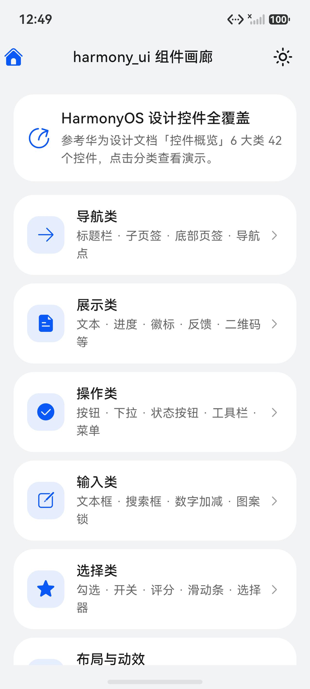
  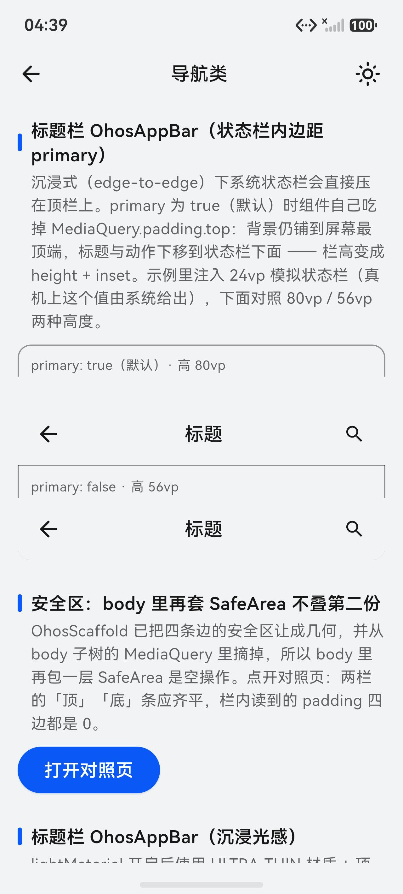
  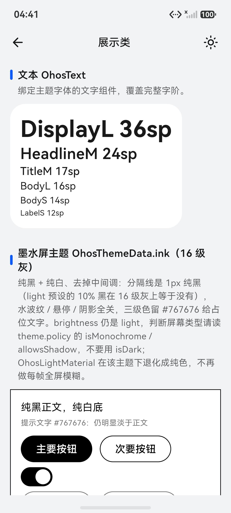
  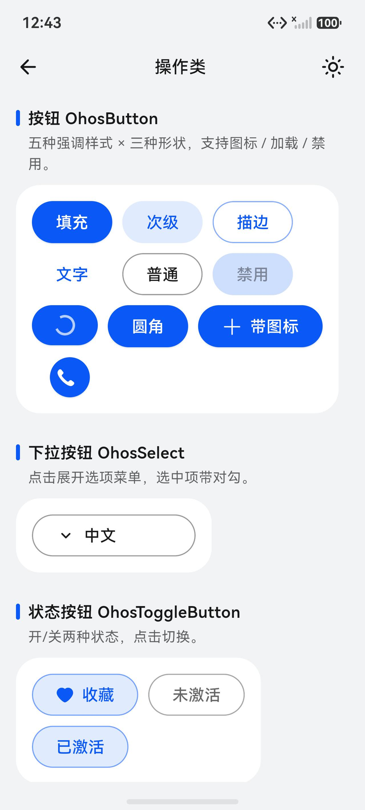
  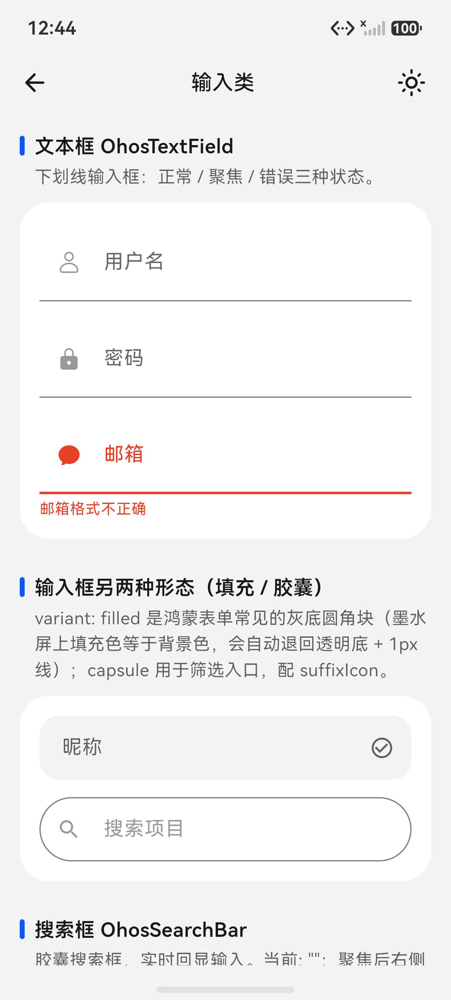
  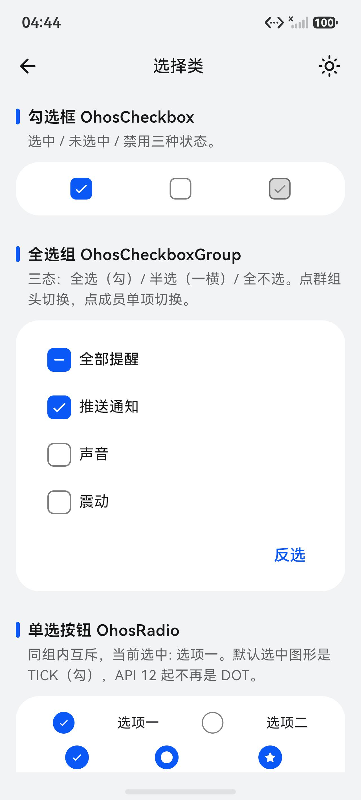
  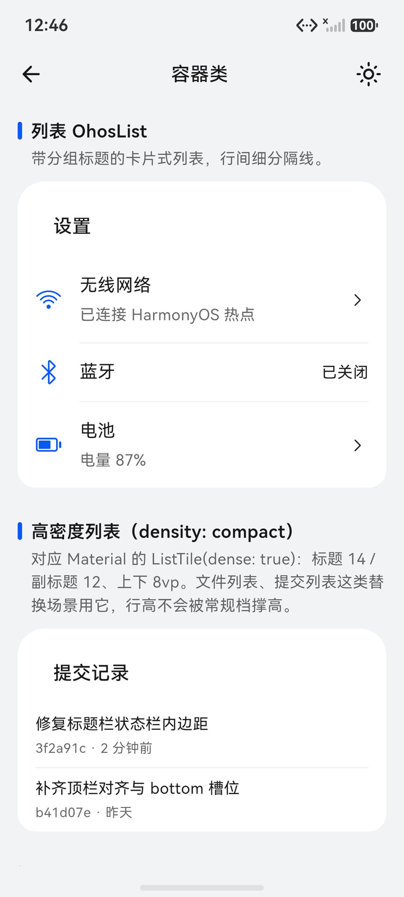
</p>

<p align="center">
  <b>同一套组件，两个维度。</b>顶栏右上角一个按钮：点按在 <b>浅色 → 深色 → 墨水屏</b>
  之间循环，长按选任意一档。
</p>

<p align="center">
  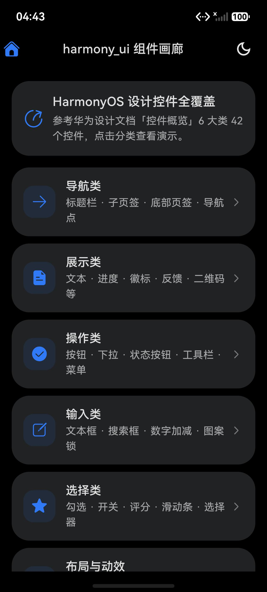
  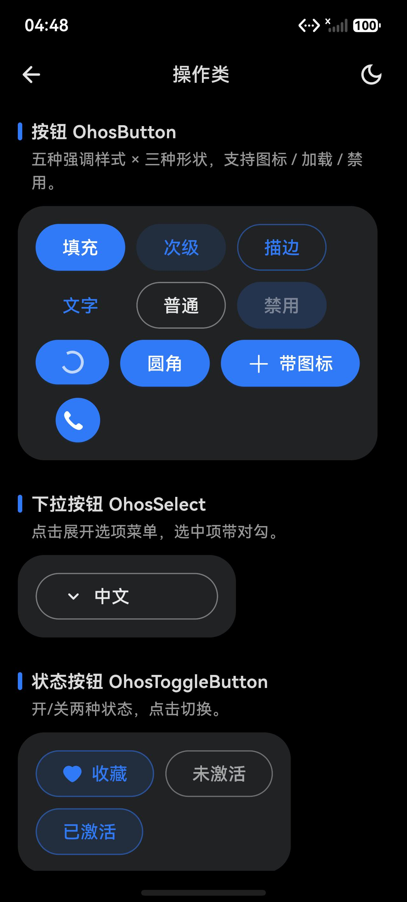
  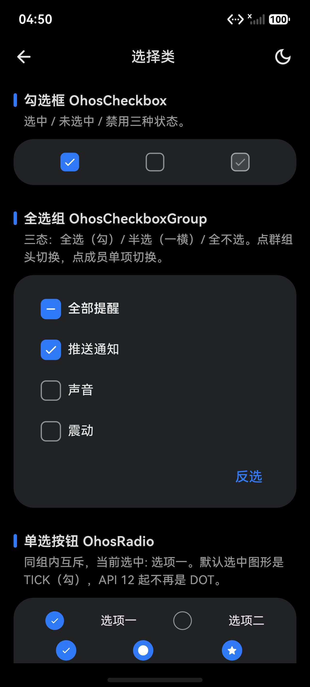
  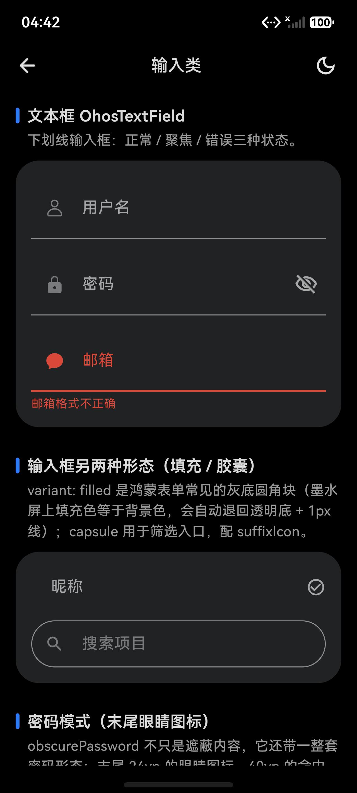
  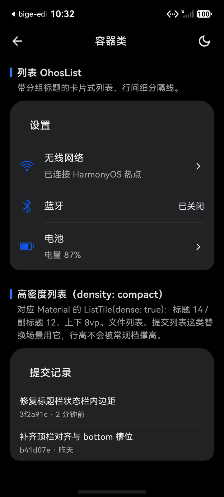
</p>

<p align="center">
  <sub><b>深色</b>：只翻令牌明暗（深底浅字），表现规则仍是彩屏 —— 有阴影、有模糊、有水波纹。</sub>
</p>

<p align="center">
  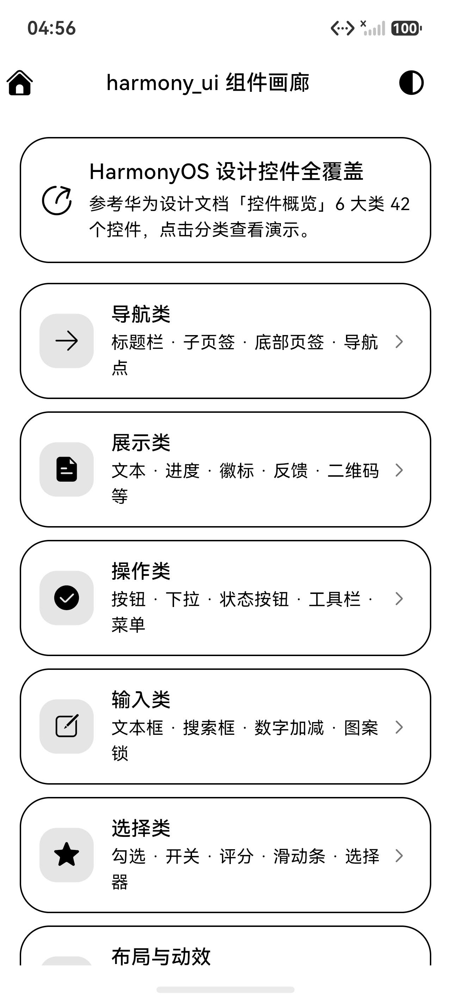
  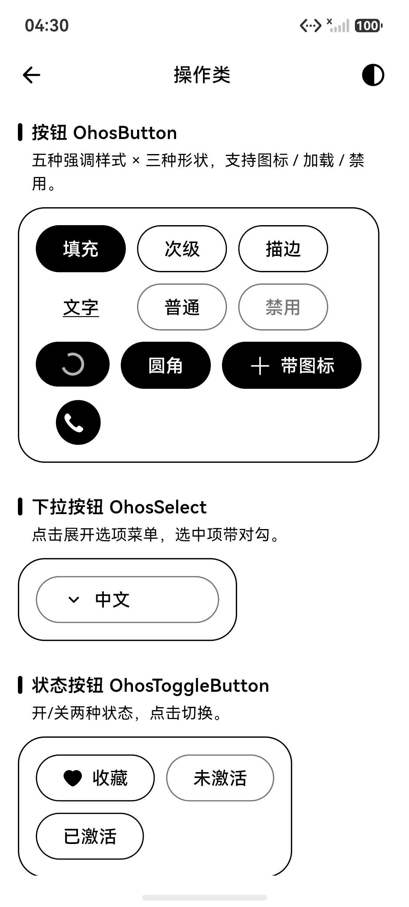
  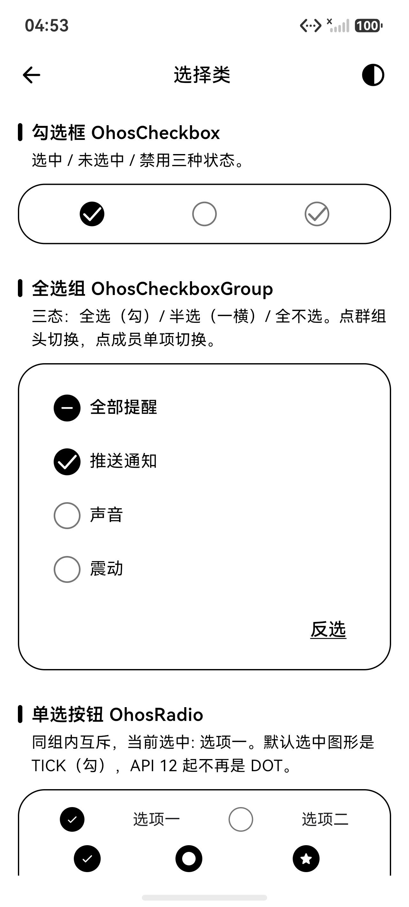
  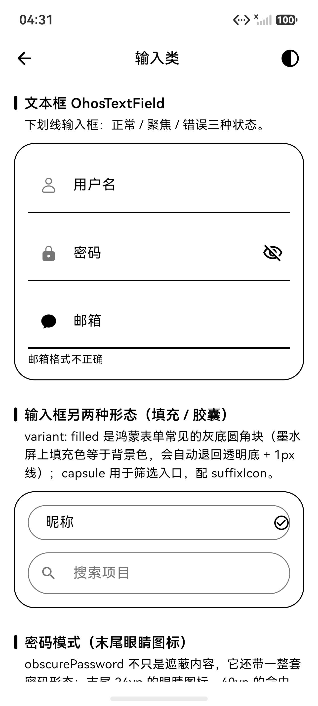
  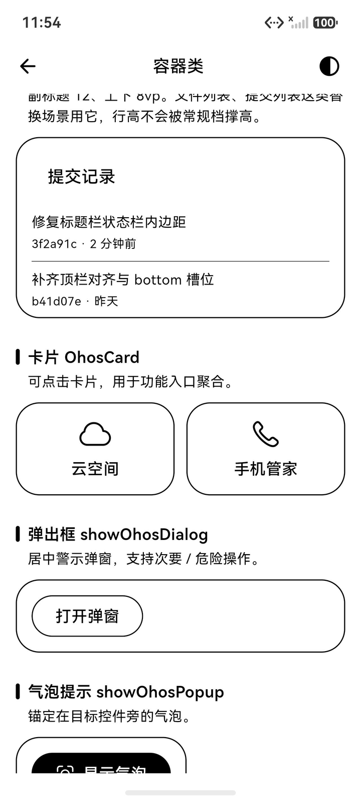
</p>

<p align="center">
  <sub><b>墨水屏</b>（16 级灰）：换的是<b>表现规则</b> —— 浅底改 1px 实线、无阴影 / 模糊 / 动效。</sub>
</p>

[](https://github.com/shaohushuo/harmony_ui/actions/workflows/ci.yml)
[](LICENSE)

> 状态：代码已发布到 GitHub，pub.dev 发布计划中（仓库：`shaohushuo/harmony_ui`，包名 `harmony_ui`）。

Material / Cupertino 风格的 Flutter 组件库，实现了 **HarmonyOS 设计语言**（华为鸿蒙「设计入门」规范），并完整覆盖官方「控件概览」文档中的 **6 大类 42 个控件**。组件命名与 API 尽可能对齐 Flutter 内置的 `Material*` / `Cupertino*` 组件，方便迁移：

| Material / Cupertino | harmony_ui |
| --- | --- |
| `Theme` / `ThemeData` | `OhosTheme` / `OhosThemeData` |
| `Scaffold` / `AppBar` | `OhosScaffold` / `OhosAppBar` |
| `ElevatedButton` / `CupertinoButton` | `OhosButton`（5 种样式 × 3 种形状） |
| `ListTile` / `CupertinoListTile` | `OhosListTile` / `OhosList` |
| `Card` | `OhosCard` |
| `Switch` / `Checkbox` / `Radio` | `OhosSwitch` / `OhosCheckbox` / `OhosRadio` |
| `TextField` / `SearchBar` | `OhosTextField` / `OhosSearchBar` |
| `NavigationBar` / `TabBar` | `OhosNavigationBar` / `OhosTabBar` |
| `Slider` / `RatingBar` | `OhosSlider` / `OhosRatingBar` |
| `AlertDialog` / `showDialog` | `OhosAlertDialog` / `showOhosDialog` |
| `SnackBar` / `showMenu` | `OhosSnackBar` / `showOhosMenu` |
| `Badge` | `OhosBadge` |
| `FilterChip` | `OhosChip` |
| `Divider` / `IconButton` | `OhosDivider` / `OhosIconButton` |

配套图标包：[ohos_icons](https://pub.dev/packages/ohos_icons)（HarmonyOS Symbol 字体图标，已发布）。

## 特性

- **HarmonyOS 设计令牌**：主题色 `#0A59F7` / `#317AF7`、11 色多彩色板、功能色、四级文字/图标透明度（90%/60%/40%/20%）、组件分层背景（`comp_background_primary/gray`）、20%/10% 品牌高亮背景（`comp_emphasize_secondary/tertiary`）与交互态色（hover/pressed/focus/select），全部对齐官方 Token 表。
- **多主题**：`OhosThemeData.light()` / `.dark()` / `.ink()`（墨水屏，可传 `brightness: Brightness.dark` 得到深色纸）开箱即用，支持 `copyWith` 定制。
- **四档 + 跟随系统**：`OhosThemeMode` 提供 `system` / `light` / `dark` / `ink`，选 `system` 时跟随系统浅色/深色并自动响应切换。`brightness` 只描述令牌明暗，与「表现规则」正交 —— 因此深色墨水屏（黑底白字）可以与白纸墨屏共用同一套组件。
- **运行时切换**：`OhosThemeController` + `OhosThemeSwitcher` + `OhosThemeToggleButton` 三件套，顶栏放一个按钮即可在运行中切换，切换不丢页面栈。墨水屏与普通主题的差异集中在 `OhosVisualPolicy`（彩屏靠分层、墨水屏靠 1px 实线），加新屏只需加一个策略子类，组件层不动。按钮的点按语义是「彩屏 ↔ 墨水屏」，深色与跟随系统在长按菜单；示例工程给了一个把它改成「点按循环 浅色 → 深色 → 墨水屏」的版本（`example/lib/theme_switch.dart`）。
- **API 对齐 Flutter**：使用方式与 Material/Cupertino 组件一致，学习成本低。
- **原生字体**：默认使用 HarmonyOS 系统字体 `HarmonyOS Sans`（非鸿蒙平台自动回退系统字体）。
- **沉浸光感材质**：`OhosLightMaterial` 实现官方 ULTRA_THIN … ULTRA_THICK 五档毛玻璃背板，支持顶部/底部渐变模糊，AppBar、底部页签、半模态面板开箱即用。
- **响应式布局**：`OhosResponsiveBuilder` + `OhosGrid` 实现 600/840vp 断点（4/8/12 列）、16/24/32vp 边距与 8/12/16vp 槽宽，侧边页签在 ≥840vp 自动生效。
- **转场动效**：`OhosGeometry` 提供与官方「转场动效」一致的弹簧/缓出曲线与 90/200/300/400ms 时长，配套「一镜到底」共享元素演示。
- **零平台依赖**：纯 Dart / Flutter 实现，唯一第三方依赖为二维码生成 `qr` 包。
- **完整控件覆盖**：官方「控件概览」6 大类 42 个控件全部实现，见下方清单。
- **UI Design Kit 增强能力**：点光源、按压阴影、侧边栏/侧边菜单、横滑列表项、常驻通知、动态模糊标题栏、可展开操作栏、分层图标、应用内多窗入口等，对照华为「UI Design Kit 能力」文档实现。
- **索引与放大镜**：`OhosAlphabetIndexer` 等高槽位（布局 / 字号 / 命中同源，父级压高度时整条跟着缩），拖动时手指旁出现放大镜；`OhosMagnifier` + `OhosMagnifierController` + `OhosMagnifierPosition` 也能独立用于文本选择等「跟随手指」的场景。

## 安装

### 通过 pub.dev（发布后）

```bash
fvm flutter pub add harmony_ui
```

### 通过 Git（当前推荐）

```bash
fvm flutter pub add harmony_ui \
  --git-url git@github.com:shaohushuo/harmony_ui.git

# 或直接在 pubspec.yaml 中声明
# dependencies:
#   harmony_ui:
#     git:
#       url: https://github.com/shaohushuo/harmony_ui.git
#       ref: main
```

## 快速开始

> **沉浸式布局**：`OhosAppBar` 默认 `primary: true`，会自己吃掉
> `MediaQuery.padding.top`（背景仍铺到屏幕最顶端，标题/动作下移到系统状态栏下面），
> 与 Material `AppBar` 的 `SafeArea(bottom: false)` 一致，直接放进 `Scaffold.appBar`
> 即可。若你已经在外层套过 `SafeArea`，或这条栏不在屏幕顶部，传 `primary: false`。
> `preferredSize` 保持 `height` —— `Scaffold` 的 `appBarMaxHeight` 已含状态栏高度，
> 重复加会多出一条空白。

```dart
import 'package:flutter/material.dart';
import 'package:harmony_ui/harmony_ui.dart';

void main() => runApp(const MyApp());

class MyApp extends StatelessWidget {
  const MyApp({super.key});

  @override
  Widget build(BuildContext context) {
    return MaterialApp(
      home: OhosTheme(
        data: OhosThemeData.light(), // 或 OhosThemeData.dark()
        child: OhosScaffold(
          appBar: OhosAppBar(title: const Text('我的应用')),
          body: Center(
            child: OhosButton(
              onPressed: () {},
              child: const Text('开始使用'),
            ),
          ),
          bottomNavigationBar: OhosNavigationBar(
            currentIndex: 0,
            onDestinationSelected: (int index) {},
            destinations: const [
              OhosNavigationDestination(
                icon: Icon(Icons.home_filled),
                label: '首页',
              ),
              OhosNavigationDestination(
                icon: Icon(Icons.person_filled),
                label: '我的',
              ),
            ],
          ),
        ),
      ),
    );
  }
}
```

## 运行时切换：明暗 / 墨水屏

墨水屏（如华为 MatePad Paper / NoteAir）上，16 级灰只能分辨出约 5 档，靠半透明
叠色、阴影、模糊分层的界面会整块糊掉。`harmony_ui` 让同一组组件在两种主题下都成
立，并且能在运行中一键来回：

```dart
// 1. 建一个控制器（`main()` 里建，或交给状态管理持有）
final OhosThemeController themeController = OhosThemeController();

// 2. 包住 MaterialApp —— 必须在**外面**，push 出去的页面才拿得到主题
OhosThemeSwitcher(
  controller: themeController,
  builder: (BuildContext context, ThemeData materialTheme) {
    return MaterialApp(
      theme: materialTheme,
      home: OhosScaffold(
        appBar: OhosAppBar(
          title: const Text('我的应用'),
          // 3. 顶栏放一个按钮：点按翻转，长按弹出跟随系统 / 浅色 / 深色 / 墨水屏
          actions: <Widget>[
            OhosThemeToggleButton(controller: themeController),
          ],
        ),
        body: const SizedBox.shrink(),
      ),
    );
  },
);

// 任意位置（包括内层页面）都能切：
themeController.toggle();      // 普通 ↔ 墨水屏，回来时仍是原来的深/浅色
themeController.mode = OhosThemeMode.dark;   // 指定档位
themeController.useMode(OhosThemeMode.dark); // 同上，但会记住「深色」供 toggle 回来
```

`OhosThemeToggleButton` 的点按语义是「在当前彩屏档位 ↔ 墨水屏之间翻转」，深色与
跟随系统在长按菜单里。**如果你的场景里深色是主要对照项**（比如组件画廊、设计走查
工具 —— 用户就是要并排看同一屏在浅色 / 深色 / 墨水屏下的样子），把它做成点按循环
更顺手：`example/lib/theme_switch.dart` 给了一个 30 行的实现，点按走
浅色 → 深色 → 墨水屏，长按弹完整菜单。

切换时 `MaterialApp` 原地重建，Navigator 的 State 会被复用，**不会把用户弹回首页**。

### 跟随系统

`OhosThemeMode.system` 把「浅色还是深色」交给系统设置，并**自动响应系统切换**
（用户改完系统深色模式，界面立刻跟着翻，不用重启）：

```dart
final theme = OhosThemeController(initialMode: OhosThemeMode.system);
```

系统亮度**不进 controller 的状态**，而是像 `MediaQuery` 一样由 Widget 树提供，
`OhosThemeSwitcher` 每次 build 时通过 `controller.resolveTheme(systemBrightness: ...)`
现算。这样设计是为了避一个坑：如果在 `build()` 里把亮度喂回 controller 再
`notifyListeners()`，监听者会在当前构建过程中再次触发重建，直接抛
`setState() or markNeedsBuild() called during build`。

`resolveTheme` / `materialThemeOf` 都是**纯函数** —— 不写状态、不通知，可以安全地在
`build` 里调用。自己管理 `OhosTheme` 而不走 `OhosThemeSwitcher` 时，用
`useTheme(controller.resolveTheme(systemBrightness: brightness))` 显式给值即可。

> 选 `system` 之后进入墨水屏再切回来，会落在**离开时那个具体明暗**（深色或浅色），
> 而不是继续停在 `system` 上 —— 否则切换按钮就成了单向门。

### 深色墨水屏

16 级灰的电子纸不只「白纸黑字」一种。夜间阅读需要黑底白字，这时候**令牌的明暗**
和**表现规则**必须能各走各的：

```dart
// 一行拿到完整的深色墨水屏：纸色 #1A1A1A、纯白字阶、禁用灰 #4D4D4D
final darkInk = OhosThemeData.ink(brightness: Brightness.dark);

darkInk.isDark;      // true  —— 令牌是深底浅字
darkInk.monochrome;  // true  —— 策略是灰阶屏
```

这两个维度是正交的，`brightness` **只描述令牌明暗**，不表示系统深色模式、不表示
档位、不表示是否跟随系统。拆开之前 `ink()` 恒为 `Brightness.light`，`isDark` 恒假，
深色墨水屏根本做不出来。

为什么不让调用方自己 `copyWith` 一批色值：一份可用的深色墨水屏至少要同时改对 6 个
色值（纸面 / 卡面 / 弹层 / 正文 / 三级文字 / 分隔线）+ 13 个 `TextStyle` + 策略里的
`paper`。少改任何一处都会变成「某处黑字压黑纸」，而且窄到跑一遍看不出来 ——
`typography` 尤其容易漏，它不跟着翻就是整段正文消失。

需要别的纸色时再用 `copyWith`，语义仍然成立：

```dart
final custom = OhosThemeData.ink().copyWith(
  brightness: Brightness.dark,
  policy: const InkVisualPolicy(paper: Color(0xFF202020)),
  typography: OhosTypography.monochrome(brightness: Brightness.dark),
  // ...纸色 / 字色 / 分隔线跟着换
);
```

### 换屏之后长什么样

同一份代码、同一个页面，只把 `initialMode` 从 `light` 换成 `ink`。对话框与半模态
面板最能看出差别 —— 墨水屏上它们**完全靠遮罩的明度差**浮起来，没有阴影、没有模糊：

<p align="center">
  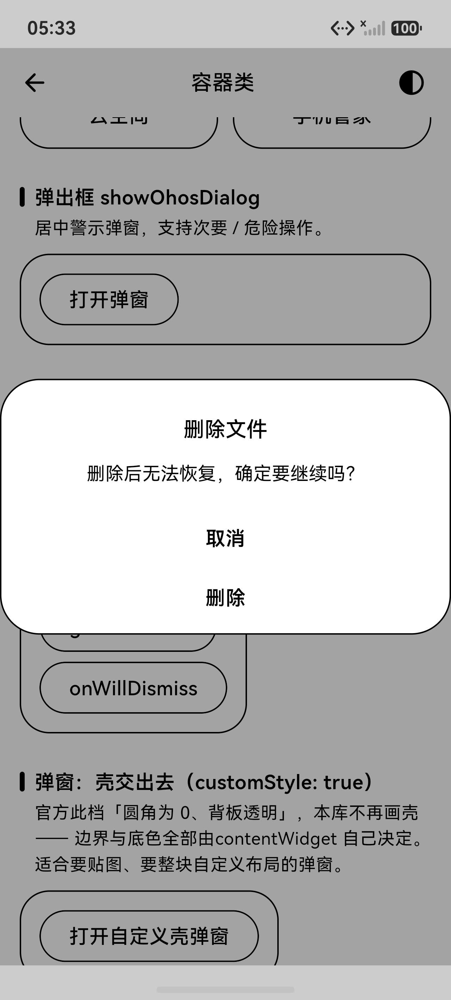
  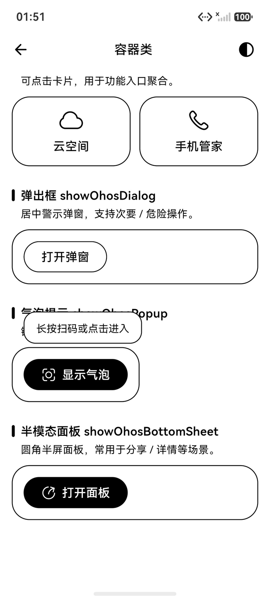
  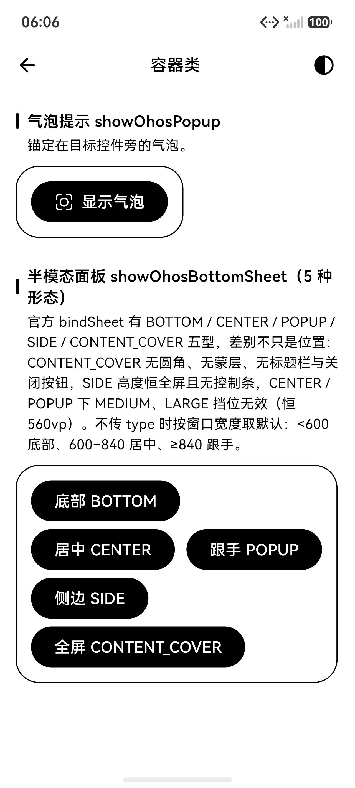
</p>

注意半模态面板里的分享图标：彩屏下每个渠道一个品牌色，墨水屏下统一退成
「灰底 + 黑图标」，靠**形状**而不是颜色区分。更多对照见文末[截图](#截图)里的
「墨水屏」一节。

### 两种主题为什么不是「深色模式的变体」

墨水屏是黑字白纸（`Brightness.light`），差别不在色值而在**表现规则**：
彩屏靠分层（20% 叠色、阴影、`BackdropFilter` 模糊、水波纹），墨水屏靠线
（1px 实线描边、留白、关掉一切动画）。这套规则收在 `OhosVisualPolicy` 里：

| 组件想表达 | 彩屏（`ColorVisualPolicy`） | 墨水屏（`InkVisualPolicy`） |
| --- | --- | --- |
| `policy.tint(base, 0.12)` | 12% 叠色 | `Colors.transparent`（托不住形体） |
| `policy.line(base, 0.4)` | 40% 的线 | 实色（丢掉 alpha） |
| `policy.allowsShadow` | `true` | `false` |
| `policy.allowsBlur` | `true` | `false` |
| `policy.allowsRipple` | `true` | `false` |
| `policy.allowsGlow` | `true` | `false` |
| `policy.scaleMotion(200ms)` | `200ms` | `Duration.zero` |

收到透明的底色就改画线 —— 这条约定替代了原先散在 24 个组件里的
`theme.monochrome ? A : B`。

`allowsGlow` 与 `allowsShadow` 分开而不是合并，因为两者在这块屏上的**失败方式不同**：
阴影不存在只是「少了点立体感」，而白色的光晕叠在纯黑字上会**直接糊掉正文**，黑底
场景下又完全看不见。灰阶屏上「光」这个隐喻本身不成立 —— 它没有背光可言。这条策略
挡住的是 `OhosPointLight`、`OhosPressShadow`、`OhosLightMaterial` 的装饰层，它们真正
的信息载体（底色、描边、图标）不受影响。

> 已有代码里的 `theme.monochrome` 仍然可用（是 `policy.isMonochrome` 的别名），
> 但新代码请读 `policy`。判断「要不要补一条线」用 `theme.usesOutlines`。

### 加第三种主题要改哪些文件

答案是「不碰 `lib/src/widgets/` 下的任何一行」。一个主题由两份东西构成：

```dart
// 1. 表现规则：这块屏上「怎么写才看得见」。不存在就不写，沿用已有两种之一。
class HighContrastPolicy extends OhosVisualPolicy {
  const HighContrastPolicy();

  @override bool get isMonochrome => false;
  @override Color tint(Color base, double alpha) =>
      base.withValues(alpha: alpha < 0.30 ? 0.30 : alpha);  // 抬地板
  @override Color line(Color base, double alpha) => base;
  @override Color quantize(Color color) => color;
  @override double? get outlineWidth => 2;      // 2px 粗线
  @override bool get allowsShadow => true;
  @override bool get allowsBlur => false;
  @override bool get allowsRipple => true;
  @override Duration scaleMotion(Duration base) => base;
  @override Color disabledFill(Color base) => base.withValues(alpha: 0.30);
}

// 2. 色值：复用任一份现成色板再改。不需要新策略时这步就够了。
final OhosThemeData highContrast = OhosThemeData.light().copyWith(
  policy: const HighContrastPolicy(),
  id: 'high_contrast',
  textPrimaryColor: const Color(0xFF000000),
  dividerColor: const Color(0xFF000000),
);

// 3. 接进切换流程：不需要往 OhosThemeMode 枚举里加值。
final controller = OhosThemeController.custom(highContrast);
controller.toggle();   // 与墨水屏互切；切回来仍是 high_contrast
```

`allowsGlow` 在基类上有默认值 `true`（而不是声明成抽象成员），所以上面这份
**已经写好的自定义策略不需要为它补一行** —— 「加一块屏 = 写一个子类」这个承诺不能
因为库里多一个能力声明就让外部代码编译失败。

`test/theme_extension_test.dart` 里有一份**完整可跑的**自定义主题，用来把这条约束
固化成回归测试：如果哪天某个 widget 又开始 `switch` 主题枚举、或硬编码某块屏的
令牌，那个测试就会先红。

### 已知的边界

- **新增内置档位**（写进 `OhosThemeMode`）仍要改两处：`OhosThemeMode.theme()` 的
  映射，和切换按钮长按菜单的取项（后者是自动遍历 `values`，不用改代码）。除此之外
  没有 widget 需要动 —— 图标对未知档位走兜底推导，不会编译失败。
- **`InkVisualPolicy.paper` 只改量化底色**，不改色值。做深色墨水屏请用
  `OhosThemeData.ink(brightness: Brightness.dark)`（或按上例 `copyWith`），否则正文
  仍是白纸上的纯黑。
- **深色墨水屏目前只有两个内置极端**（`#FFFFFF` 纸 / `#1A1A1A` 纸）。中间调纸色
  （如 `#3A3A3A`）请自行 `copyWith`，并**同时**换 `policy` 的 `paper` 与
  `typography` —— 三者不一致时量化与字色会各自偏向不同方向。
- **持久化留给应用层**。核心库只提供 `OhosThemeData.id` 这个稳定字符串
  （`'light'` / `'dark'` / `'ink'` / `'ink_dark'`），不引入 `shared_preferences`
  之类的依赖。
- **`system` 档的持久化要存「这一档」，不要存解析结果**。存成 `dark` 会让应用下次
  启动后不再跟随系统。

## 应用案例

> 展示基于 harmony_ui 构建的真实应用与开源项目，欢迎[提交你的作品](https://atomgit.com/oh-flutter/harmony_ui/issues)。

<table>
  <tr>
    <td width="14%" align="center" valign="middle">
      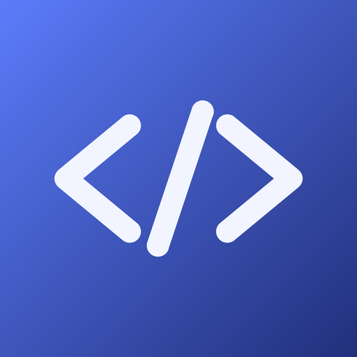
      <br/>
      <sub>Powered by</sub>
      <br/>
      <strong><font color="#1677FF">harmony_ui</font></strong>
    </td>
    <td width="26%" valign="middle">
      <h3>bige-editor</h3>
      <p><b>开源项目 · 工具类</b></p>
      <p>
        代码阅读器 / 编辑器 + Git 客户端：在手机和平板上读仓库、看代码、
        改一行、提交上去，不需要电脑。同一份 Dart 代码出鸿蒙 hap 与 Android apk 两种形态。
      </p>
      <p>👤 作者：eltoro</p>
      <p>
        <a href="https://atomgit.com/eltoro/bige-editor">
          
        </a>
      </p>
    </td>
    <td width="46%" align="center" valign="middle">
      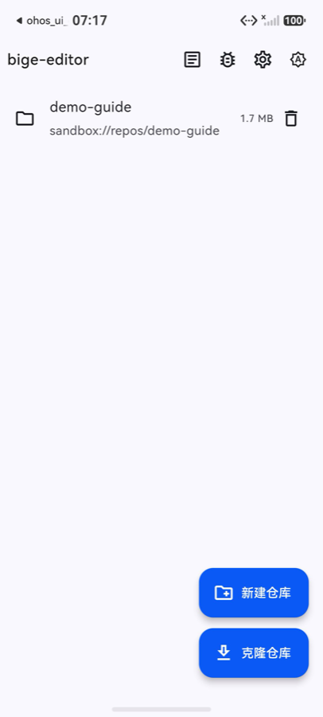
      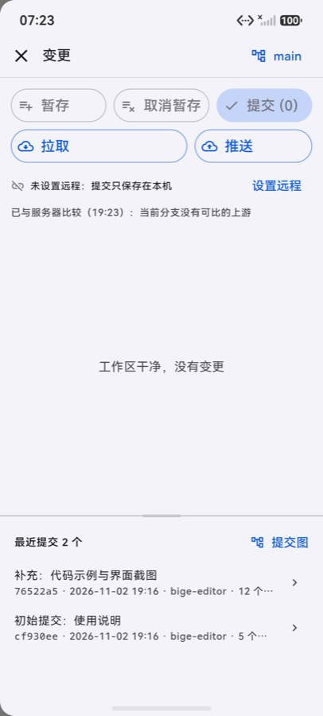
      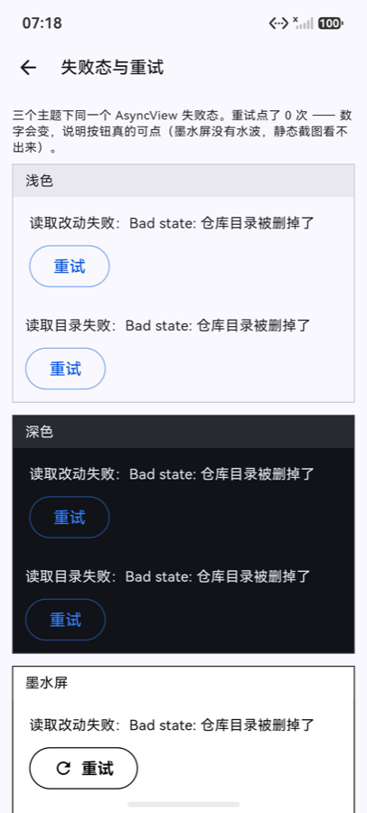
    </td>
    <td width="14%" align="center" valign="middle">
      <a href="https://appgallery.huawei.com/app/detail?id=ltd.chencan.bige_editor&amp;channelId=SHARE&amp;source=appshare">
        
      </a>
      <br/>
      <sub>扫码下载</sub>
    </td>
  </tr>
</table>

上表三张截图分别取自**仓库列表**、**变更与提交**、**同一份错误态在浅色 / 深色 /
墨水屏三档下的对照** —— 第三张最能说明这套组件库要解决的问题：同一段业务代码，
换一块屏不用改一行布局，输入框自动从「灰底无边框」变成「白底 + 1px 黑描边」，按钮
自动去掉水波纹与阴影。

这个应用也验证了几个关键约束：

- **零组件改动接入** —— bige-editor 只用到 `OhosThemeData.light()` / `.dark()` /
  `.ink()` 与 `copyWith`（8 个颜色令牌），0.5.0 的策略化重构对它**没有**任何源码
  影响。
- **墨水屏可用** —— 索引条受控高亮、无底纹按钮仍可点、输入框描边可读，均在真机
  与模拟器上验证过。
- **深色墨水屏不再是理论组合** —— `OhosThemeData.ink(brightness: Brightness.dark)`
  就是为这类「夜间读代码」场景准备的。

## 控件覆盖（对应官方「控件概览」42 控件）

### 导航类

| 控件 | 实现 |
| --- | --- |
| 标题栏 | `OhosAppBar` |
| 子页签 | `OhosTabBar` |
| 底部页签 | `OhosNavigationBar` |
| 导航点 | `OhosPageIndicator`（见 `ohos_swiper.dart`）|
| 轮播 | `OhosSwiper` |

### 展示类

| 控件 | 实现 |
| --- | --- |
| 文本 / 子标题 | `OhosText`（`OhosTextLevel` 全字阶）/ `OhosSubheader` |
| 图片 | `OhosImage`（支持选中描边）|
| 分隔器 | `OhosDivider` |
| 进度条 | `OhosProgressIndicator`（圆形 / 线性）|
| 新事件标记 | `OhosBadge`（数字 / 红点）|
| 索引条 | `OhosAlphabetIndexer`（等高槽位 · 拖动放大镜 · `selectedIndex` 受控高亮 · `onSelectEnd`）|
| 放大镜 | `OhosMagnifier` / `OhosMagnifierController` / `OhosMagnifierPosition`（跟随手指的浮层，也可用于文本选择）|
| 滚动条 | `OhosScrollbar` |
| 即时反馈 / 即时操作 | `showOhosToast` / `showOhosSnackBar` |
| 气泡提示 | `showOhosPopup` |
| 数据可视化 | `OhosDataPanel` |
| 二维码 | `OhosQrCode` |
| 空白 | `OhosBlank` |
| 文本时钟 | `OhosTextClock` |

### 操作类

| 控件 | 实现 |
| --- | --- |
| 按钮 | `OhosButton`（filled / tonal / outlined / text / plain × 胶囊 / 圆角 / 圆形）|
| 下拉按钮 | `OhosSelect` |
| 状态按钮 | `OhosToggleButton` |
| 操作块 | `OhosChip` |
| 工具栏 | `OhosToolbar` |
| 核心操作栏 | `OhosActionBar` |
| 菜单 | `showOhosMenu`（列表 / 宫格）|

### 输入类

| 控件 | 实现 |
| --- | --- |
| 文本输入 | `OhosTextField`（正常 / 聚焦 / 错误态）|
| 搜索框 | `OhosSearchBar` |
| 数字加减 | `OhosCounter` |
| 图案锁 | `OhosPatternLock` |

### 选择类

| 控件 | 实现 |
| --- | --- |
| 勾选框 / 单选按钮 / 开关 | `OhosCheckbox` / `OhosRadio` / `OhosSwitch` |
| 评分条 | `OhosRatingBar`（支持半星）|
| 滑动条 | `OhosSlider`（刻度 / 气泡数值）|
| 选择器 | `showOhosPicker` |
| 颜色选择器 | `OhosColorPicker` |
| 分段按钮 | `OhosSegmentedButton` |

### 容器类

| 控件 | 实现 |
| --- | --- |
| 列表 / 列表项 | `OhosList` / `OhosListTile` |
| 卡片 | `OhosCard` |
| 弹出框 | `OhosAlertDialog` / `showOhosDialog` |
| 气泡提示 | `showOhosPopup` |
| 半模态面板 | `showOhosBottomSheet` |

## 设计语言实现（对齐官方设计规范）

实现均对照官方文档的「色彩」「布局」「沉浸光感」「响应式」「转场动效」章节，示例代码见 `example/lib/pages/layout_page.dart` 与 `navigation_page.dart`。

### 色彩 Token

`OhosColors` 与 `OhosThemeData` 中的颜色 1:1 对应官方 Token 表（`0xAARRGGBB`）：

- 文字/图标四级：`font_primary #E5000000`、`font_secondary #99000000`、`font_tertiary #66000000`、`font_fourth #33000000`（深色模式对应白色系列）。
- 背景分层：`background_secondary #F1F3F5`（页面）、`background_tertiary #E5E5EA`、`comp_background_primary #FFFFFF`（卡片/组件）、`comp_background_gray #F1F3F5`（灰底）。
- 品牌高亮背景：`comp_emphasize_secondary #330A59F7`（20%）、`comp_emphasize_tertiary #190A59F7`（10%），用于选中态与悬浮强调。
- 交互事件色：`interactive_hover #0C000000`、`interactive_pressed #19000000`、`interactive_focus #FF0A59F7`、`interactive_select #330A59F7`。
- 组件直接取主题字段：`theme.emphasizeSecondaryColor`、`theme.compBackgroundGrayColor`、`theme.interactivePressedColor` 等。

### 沉浸光感（Immersive Light）

```dart
// 顶部悬浮：ULTRA_THIN + 渐变模糊
OhosLightMaterial(
  level: OhosLightMaterialLevel.ultraThin,
  gradientFade: OhosLightFade.top,
  child: OhosAppBar(lightMaterial: true, title: const Text('标题')),
)

// 底部悬浮：THIN + 渐变蒙层，光池跟随选中项，按压出现指尖光晕
OhosNavigationBar(
  type: OhosNavigationBarType.float,
  lightMaterial: true,
  glow: true,
  destinations: destinations,
  ...
)

// 半模态 / 大弹层：ULTRA_THICK（可开启光感漫射）
OhosLightMaterial(
  level: OhosLightMaterialLevel.ultraThick,
  effectTuning: const OhosLightEffectTuning(scatterScale: 0.6),
  child: panel,
)
showOhosBottomSheet(context: context, title: '分享', content: ...);
```

材质由多层合成，对应官方「沉浸光感」的各层描述：

- 五档模糊强度：ULTRA_THIN=8、THIN=16、REGULAR=24、THICK=32、ULTRA_THICK=40（sigma），各档带有独立的表面填充/光池/高光/阴影/漫射参数。
- 光池（glow pools）：`OhosLightPalette.glowColors` 彩色光晕在介质内漫溢，`glowAlignment` 移动时产生「光跟随交互」的效果（底部页签选中项、按压位置）。
- 镜面高光与边缘高光：`animationValue` 驱动高光扫掠，上边缘画 rim 亮边与顶缘发丝高光。
- 光感漫射：`OhosLightEffectTuning.scatterScale` 开启背景放大折射带（默认关闭以省性能）。
- 调参：`OhosLightEffectTuning`（blur/surface/glow/shadow/specular/scatter 六项倍率），可模拟官方「强/均衡/弱」三档。
- `OhosBottomSheet` 默认 ULTRA_THICK；`OhosAppBar(lightMaterial: true)` 默认 ULTRA_THIN。

> 技术参考（MIT）：材质分层思路借鉴自
> [harmony_immersive_glow_tabbar](https://gitcode.com/ZuoYueLiang/harmony_immersive_glow_tabbar)
> 与 [liquid_glass_widgets](https://pub.dev/packages/liquid_glass_widgets)。
> 注意 `liquid_glass_widgets` 要求 Flutter ≥ 3.41.0，而鸿蒙社区分叉为
> `oh-3.35.7-release`（3.35.x），无法直接依赖，故采用同思路的自绘实现。

### 布局基础（栅格 / 断点 / 边距）

- 断点：`<600vp` 紧凑 / `600–840vp` 中 / `≥840vp` 宽；栅格 4/8/12 列，边距 16/24/32vp，槽宽 8/12/16vp，内容最大 2220vp。
- `OhosResponsiveBuilder` 依据窗口宽度重建子树；`OhosGrid` + `OhosGridItem(columnSpan:)` 直接按栅格排布：

```dart
OhosGrid(
  children: [
    OhosGridItem(columnSpan: 2, child: card),
    OhosGridItem(columnSpan: 2, child: card),
  ],
)
```

### 响应式布局方法

- **挪移**：`OhosNavigationBar` 为纯内容组件；在宽屏（≥840vp）建议配合侧边页签使用（导航结构文档的「侧边 Tab」模式），示例可参考 `OhosWindowSize.useSideTab`。
- **折行/缩放/分栏**：`example` 的「响应式断点」演示按断点切换 1/2/4 列，展示 compact/medium/large 三种窗口形态。

### 转场动效（Transition / Motion）

- 运动曲线：`OhosGeometry.spring`（按压反馈）、`easeOut`（界面转场）、`sharedElement`（一镜到底共享转场）。
- 时长：90ms 按压反馈 / 200ms 普通转场 / 300ms 共享转场 / 400ms 页面转场。
- 层级关系：同层级（编辑/页签）、上下层级（父子页面）、跨层级（应用间）分别对应不同曲线。
- 一镜到底：共享元素放大转场演示见「转场动效 一镜到底」Demo（`AnimatedContainer` + `sharedElement` 曲线）。

### 与官方控件的重点一致性

| 规范点 | 官方值 | 实现 |
| --- | --- | --- |
| 下划线子页签指示条 | 24×3vp 品牌色 | `OhosTabBar`（underline） |
| 胶囊子页签激活填充 | 品牌色实色填充 | `OhosTabBar(type: capsule)` / `OhosChipGroup` |
| 胶囊子页签未激活背景 | `comp_background_gray` 灰底 | `OhosChipGroup` |
| 胶囊间距 | 不宜过大（默认 8vp） | `OhosChipGroup(spacing: 8)` |
| 底部页签高度 | 平铺 48vp / 悬浮 56vp | `OhosNavigationBar` 默认值 |
| 底部页签激活高亮 | 20% 品牌色 `comp_emphasize_secondary` | `OhosNavigationBar` 选中胶囊 |
| 图标尺寸 | 24×24vp | `OhosNavigationBar(iconSize: 24)` |
| 页签数量建议 | 3–5 个 | 文档建议，未强制 |


## UI Design Kit 增强组件（对照华为「UI Design Kit 能力」文档）

实现均对照华为开发者文档「[UI Design Kit 简介](https://developer.huawei.com/consumer/cn/doc/doccenter-capabilities/ui-design-introduction.md)」
能力清单（点光源、按压阴影、侧边栏/侧边菜单、横滑列表项、常驻通知、动态模糊标题栏、
可展开操作栏、分层图标、应用内多窗入口等），示例代码见 `example/lib/pages/kit_page.dart`（示例首页 →「UI Design Kit」分类）。

<p align="center">
  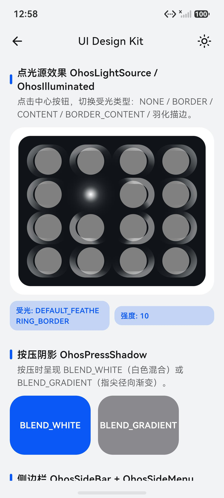
  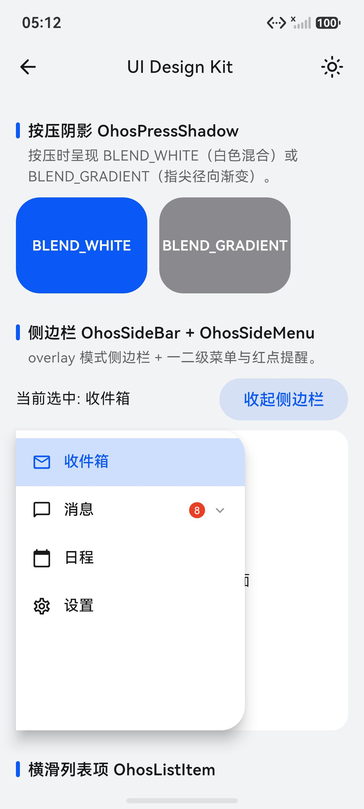
  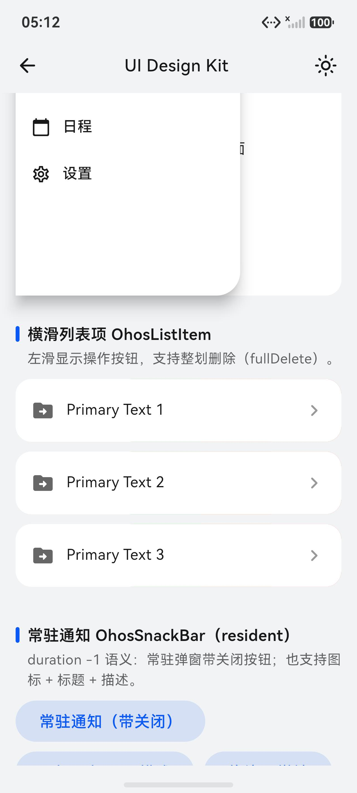
  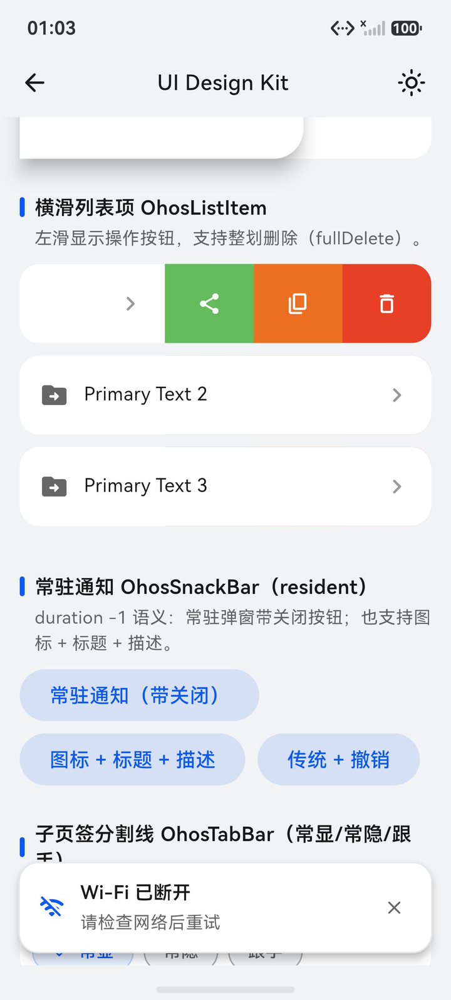
  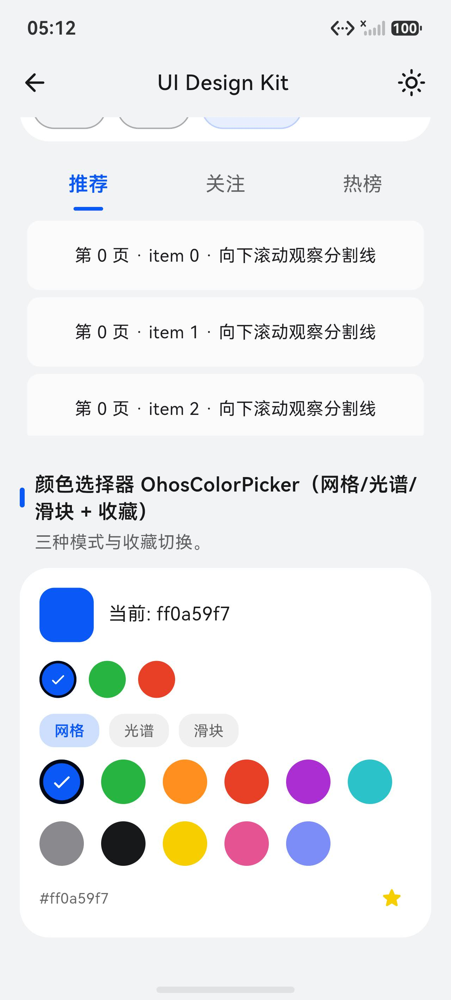
  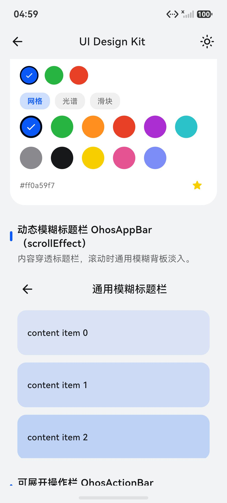
  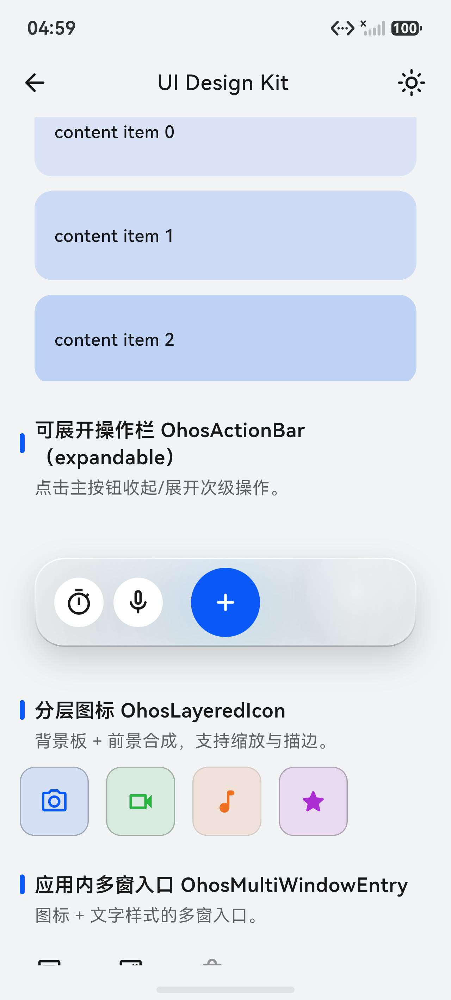
  
  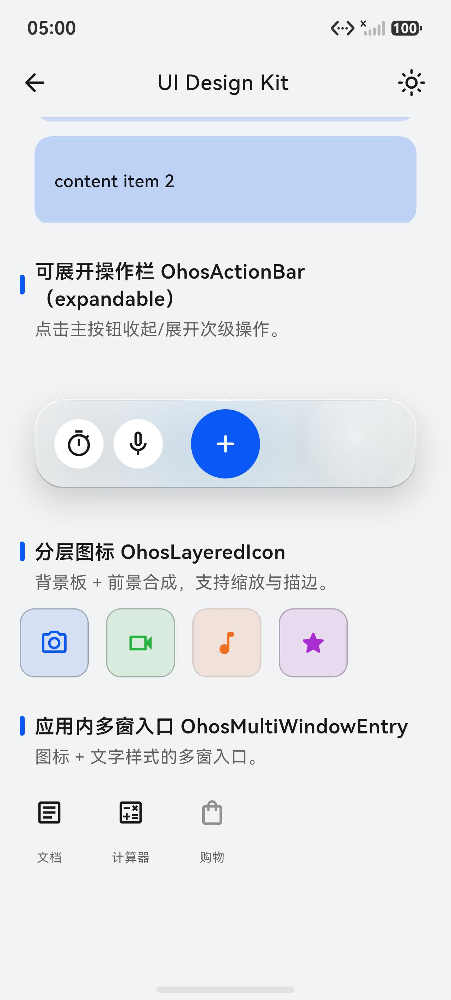
</p>

### 点光源（PointLight）

ArkUI `PointLight`（点光源）能力：发光源 `OhosLightSource` 朝 `OhosIlluminated`
受光面按类型投射环境光与「光晕 + 光柱」效果，支持 5 种受光类型与强度调节。
模拟器不支持原生 HDS 光影（文档明确），本实现用自绘合成达到同样的视觉层次。

```dart
OhosIlluminated(
  illuminatedType: OhosPointLightIlluminatedType.borderContent, // none/border/content/borderContent/defaultFeatheringBorder
  lightAlignment: const Alignment(0.2, 0.3),
  options: const OhosPointLightOptions(color: Colors.white, intensity: 12, height: 150),
  borderRadius: BorderRadius.circular(22),
  child: card,
)
// 发光源（举例：卡片中心的圆钮）
OhosLightSource(size: 34, options: const OhosPointLightOptions(intensity: 10, height: 150))
```

### 按压阴影（PressShadow）

`OhosPressShadow` 对应 ArkUI `visualEffect(pressShadow)`：按压时表面
`BLEND_WHITE`（白色混合）或 `BLEND_GRADIENT`（指尖径向渐变），抬手淡出。

```dart
OhosPressShadow(
  type: OhosPressShadowType.blendGradient,
  borderRadius: BorderRadius.circular(24),
  child: card,
)
```

### 侧边栏 + 侧边菜单（SideBar / SideMenu）

- `OhosSideBar`：overlay 悬浮侧边栏，圆角尾缘、遮罩、点外部自动收起、展开动画。
- `OhosSideMenu` / `OhosSideMenuItem` / `OhosSideMenuSubItem`：一/二/三级菜单、展开态、红点与数字角标。

```dart
OhosSideBar(
  isShowSideBar: _show,
  onIsShowSideBarChanged: (bool v) => setState(() => _show = v),
  overlay: true,
  width: 230,
  sideBar: OhosSideMenu(
    items: const [
      OhosSideMenuItem(label: '收件箱', icon: Icon(Icons.mail_outline_rounded)),
      OhosSideMenuItem(label: '消息', icon: Icon(Icons.chat_bubble_outline_rounded),
        badgeCount: 8, subItems: [OhosSideMenuSubItem(label: '短信', badgeCount: 50)]),
    ],
    selectedValue: _selected,
    onSelected: (String v) => setState(() => _selected = v),
  ),
  content: const MyPage(),
)
```

### 横滑列表项（SwipeAction）

`OhosListItem` 左滑显示操作按钮，支持整划删除（`fullDelete`），滑动越界自动回调并移除。

```dart
OhosListItem(
  fullDelete: true,
  onFullDelete: () => setState(() => rows.removeAt(i)),
  actions: [
    OhosSwipeAction(icon: const Icon(Icons.share_rounded), backgroundColor: const Color(0xFF64BB5C), onTap: () {}),
    OhosSwipeAction(icon: const Icon(Icons.delete_outline_rounded), backgroundColor: theme.dangerColor, onTap: () {}),
  ],
  child: row,
)
```

### 常驻通知（Resident SnackBar）

`showOhosSnackBar(resident: true)`：duration -1 语义，常驻显示直到点击关闭按钮，
支持图标 + 标题 + 描述与「传统消息 + 撤销」组合。

### 子页签分割线（Divider Follow-Scroll）

`OhosTabBar` 新增 `OhosTabBarDividerMode.visible / none / followScroll`：
常显、常隐、以及绑定滚动控制器「跟手」——内容滑动时分割线淡入，回顶淡出。

### 颜色选择器（三模式 + 收藏）

`OhosColorPicker` 提供 网格 / 光谱 / 滑块 三种模式与收藏管理：

```dart
OhosColorPicker(
  colors: const [Color(0xFF0A59F7), /* ... */],
  selectedColor: _color,
  onChanged: (Color c) => setState(() => _color = c),
  tabs: const [OhosColorPickerTab.grid, OhosColorPickerTab.spectrum, OhosColorPickerTab.sliders],
  favoriteColors: _favorites,
  onFavoritesChanged: (List<Color> c) => setState(() => _favorites = c),
)
```

### 动态模糊标题栏（AppBar Scroll Effect）

`OhosAppBar` 的 `scrollEffect`：内容穿透标题栏滚动，滚动到阈值区间后
`commonBlur / transitionBlur / gradientBlur` 背板淡入（BackdropFilter 动态模糊）。

```dart
OhosAppBar(
  backgroundColor: Colors.transparent,
  title: const Text('标题'),
  scrollController: _scroller,
  scrollEffect: const OhosAppBarScrollEffectOptions(
    effect: OhosAppBarScrollEffectType.commonBlur,
    blurEffectiveStartOffset: 0,
    blurEffectiveEndOffset: 60,
    blurSigma: 10,
  ),
)
```

### 可展开操作栏（Expandable ActionBar）

`OhosActionBar(expandable: true)`：悬浮宫格操作栏，主按钮收起/展开次级操作。

### 分层图标与多窗入口

- `OhosLayeredIcon`：背景板 + 前景图标合成，支持缩放与描边。
- `OhosMultiWindowEntry`：应用内多窗入口，无多窗能力设备自动禁用（灰化、不可点）。

## 索引与放大镜（AlphabetIndexer / Magnifier）

索引条改为**等高槽位**并支持受控高亮，拖动时手指旁出现放大镜；标题栏可以把状态栏
那一段单独着色。示例见 `example/lib/pages/display_page.dart`（展示类 →「索引条
OhosAlphabetIndexer」「放大镜 OhosMagnifier」）与
`example/lib/pages/navigation_page.dart`（导航类 →「状态栏分段着色」）。

<p align="center">
  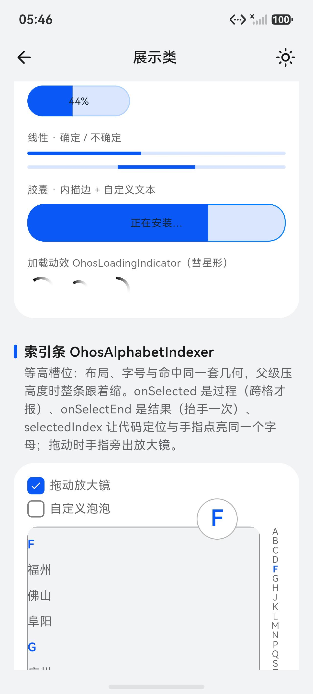
  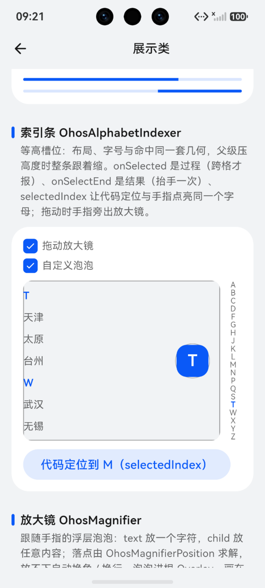
  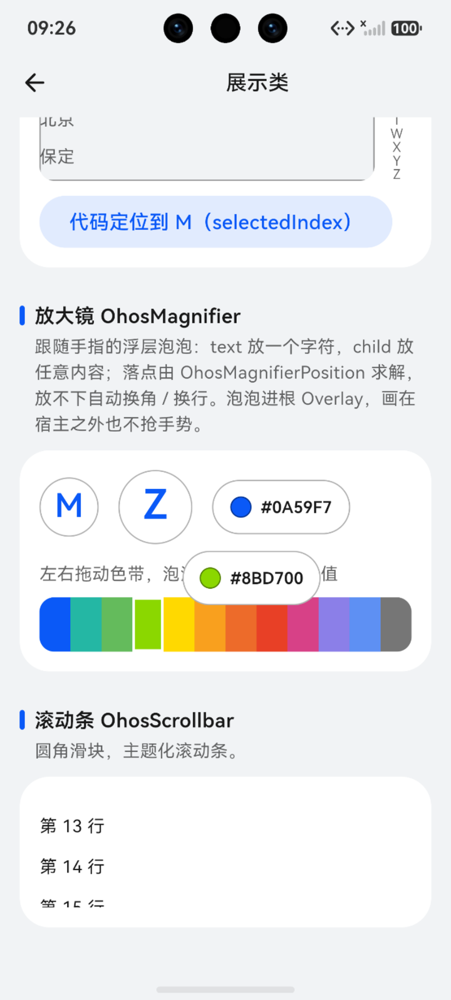
  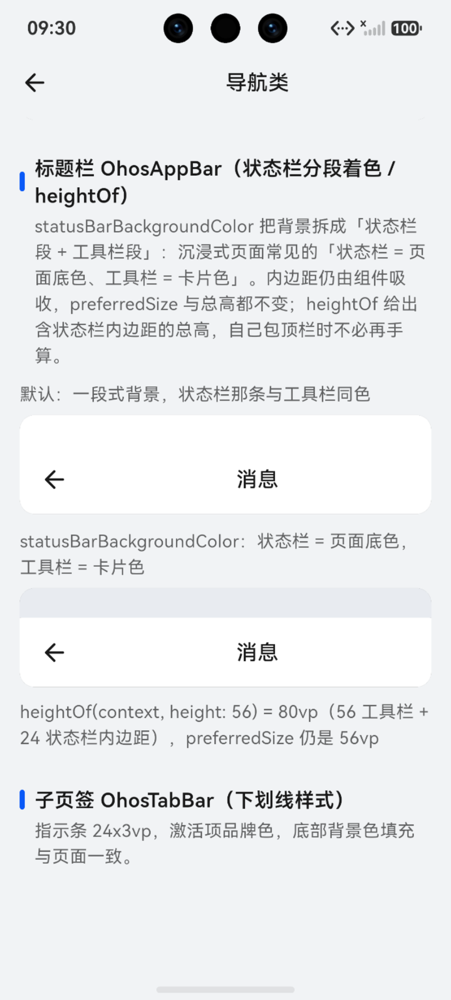
</p>

### 索引条 OhosAlphabetIndexer

- **等高槽位**：布局、字号与「`dy → 字母`」命中用同一个 slot 高度，视觉格与命中格
  完全重合；槽位高度取自父级约束（`LayoutBuilder` 的 `constraints.maxHeight`，无界
  时退回 `size.height`）。调用方不再需要按 `size` 手算第二套几何。
- **`size` 只是上限**：宽度按原值使用，高度是期望值 —— 父级给的高度更小时整条跟着
  缩、字号同步缩小（可拖分隔条的面板把 22 字母压到 130 高时不再 `overflowed`）。
- **整条都是命中区**（`HitTestBehavior.opaque`）：24vp 宽的条只有中间约 12vp 可点的
  日子过去了，字间空隙与两侧留白不再把事件漏给 `Stack` 下层的列表。

三条通道各司其职：

| 通道 | 触发时机 | 典型用途 |
| --- | --- | --- |
| `onSelected` | **过程**：点按落指必报（含当前已高亮的字母）；拖动只在跨格时报，逐帧不通知 | 列表 `jumpTo` 跟手 |
| `onSelectEnd` | **结果**：tap up / drag end / drag cancel，恰好一次，带回最终字母 | 「松手才定位」、Toast |
| `selectedIndex` | 代码发起的定位（恢复上次位置 / 索引与列表互跳） | 受控高亮，不必订阅滚动 |

```dart
OhosAlphabetIndexer(
  indexer: const <String>['A', 'B', /* … */ 'Y', 'Z'],
  size: const Size(24, 220),
  selectedIndex: _selected,        // 代码定位到 M 也点亮 M
  showMagnifier: true,             // 拖动时手指旁的泡泡（点按不显示）
  magnifierBuilder: (BuildContext context, String letter) => myBubble(letter),
  onSelected: _jumpTo,             // 过程：跨一格定位一次
  onSelectEnd: (String letter) => showOhosToast(context, '定位到 $letter'),
)
```

> **从 0.3.0 升级到 0.4.0**：`itemHeight` 已删除，槽位高度改由父级约束决定。旧写法
> `itemHeight: perLetter` + `size` 高 `perLetter × 字母数` 的结果不变，删掉这个
> 实参即可。

### 放大镜 OhosMagnifier

三个角色分开：**画什么**（`OhosMagnifier`）、**挂在哪**（`OhosMagnifierController`）、
**放在哪**（`OhosMagnifierPosition`）。

```dart
// 泡泡本体：text 放一个字符，child 放任意内容（child 优先）
const OhosMagnifier(text: 'M');
const OhosMagnifier(text: 'Z', size: Size.square(60));
OhosMagnifier(child: myCapsule, size: const Size(112, 44));
```

```dart
// 跟随手指：拖动的三段分别对应 show / update / hide
final OhosMagnifierController _magnifier = OhosMagnifierController();

void _onDragStart(DragStartDetails details) => _magnifier.show(
      context,
      anchor: details.globalPosition, // 全局坐标
      text: _valueAt(details.localPosition),
      bubble: const Size(112, 44),
      gap: 16,
    );

void _onDragUpdate(DragUpdateDetails details) => _magnifier.update(
      details.globalPosition,
      text: _valueAt(details.localPosition),
    );

void _onDragEnd(DragEndDetails details) => _magnifier.hide();

@override
void dispose() {
  _magnifier.dispose(); // 释放 OverlayEntry，State.dispose 里必须调
  super.dispose();
}
```

- 泡泡进的是**根 `Overlay`**（`MaterialApp` / `WidgetsApp` 提供），所以能画在宿主
  `SizedBox` 之外；整颗 `IgnorePointer`，不抢宿主手势。祖先没有 `Overlay` 时 `show`
  返回 `false` 并打一条 `debugPrint`，不显示也不崩。
- 落点是纯函数 `OhosMagnifierPosition.resolve`（无 RenderObject，边界情况可直接单测）：
  泡泡落在手指的**四个角**之一，纵横向各留 `gap`；该角放不下就翻到同行另一个角、
  再换到另一行；四个角都放不下才夹进安全区，此时 `placement.side` 按**夹紧后的最终
  矩形**重算 —— 沿用首选角会让调用方把箭头 / 尾巴画到反方向。
- `OhosMagnifierSide.auto`（默认）取离屏幕内侧更近的那个角；宽度上限为可用宽度的
  一半，避免泡泡把整条索引条盖住。
- 墨水屏（`OhosThemeData.ink()`，即 `monochrome`）下自动换成纯黑描边并关掉入场动画。

### 标题栏状态栏分段着色

```dart
OhosAppBar(
  title: const Text('消息'),
  backgroundColor: theme.cardColor,               // 工具栏段
  statusBarBackgroundColor: theme.backgroundColor, // 状态栏段（MediaQuery.padding.top）
)

// 自己包顶栏时用 heightOf 拿含状态栏内边距的总高，不必手算
final double total = OhosAppBar.heightOf(context, height: 56, bottom: tabBar);
```

- `primary: true`（默认）时背景被拆成两段，内边距仍由组件吸收：布局与总高不变。
  `preferredSize` 恒为 `height + bottom.preferredSize.height`（不含内边距，因为
  `Scaffold` 的 `appBarMaxHeight` 已经加过一次，重复加会多出一条空白）。
- 名字刻意不叫 `statusBarColor`：那是 `SystemUiOverlayStyle` 里控制图标明暗的字段。
- 与 `scrollEffect` / `lightMaterial` 叠加时，这一段保持纯色，不参与滚动驱动的
  重着色。

### 安全区只让一次

`OhosScaffold` 与 `OhosAppBar` 对 `MediaQuery.padding` 的认领口径：

| 场景 | 顶部内边距由谁让 | 底部内边距由谁让 |
| --- | --- | --- |
| `appBar: OhosAppBar(primary: true)` | 标题栏自己（背景铺到屏幕顶端，标题下移） | 有 `bottomNavigationBar` 时由它让，body 不再让 |
| `appBar: OhosAppBar(primary: false)` | `OhosScaffold` 替它让一次 | 同上 |
| 没有 `appBar` | `OhosScaffold` 的 body | 同上 |

- 四条边到这里都已由「栏 / 页面容器 / 底部导航」认领完毕，`OhosScaffold` 会把它们
  一并从 body 子树的 `MediaQuery` 里摘掉：body 里再包一层 `SafeArea` 是空操作，
  `MediaQuery.paddingOf(context)` 读到的四边都是 0。对照演示见导航类「安全区：
  body 里再套 SafeArea 不叠第二份」。
- 需要贴着屏幕边缘绘制（背景要铺到状态栏底下）时，原始内边距读
  `View.of(context).padding`；`MediaQuery.viewPaddingOf` 会被同一处一起摘掉，不可靠。
- 同一条内边距让两次 = 多出一条空白；一次都不让 = 内容压进状态栏。`primary: false`
  只用于「这条栏不在屏幕顶部」，或栏被放在 `OhosScaffold` 之外、调用方已自己让过。

## 使用示例


### 主题

```dart
final OhosThemeData theme = OhosTheme.of(context); // 任意组件内获取
theme.highlightColor;        // 品牌色 #0A59F7
theme.backgroundColor;       // 页面背景
theme.cardColor;             // 卡片背景
theme.multiColors;           // 11 色多彩色板
theme.typography.bodyLarge;  // 文字样式
```

```dart
OhosTheme(
  data: OhosThemeData.dark().copyWith(
    highlightColor: const Color(0xFF0A59F7),
    dangerColor: const Color(0xFFE84026),
  ),
  child: const MyApp(),
)
```

### 按钮

```dart
OhosButton(onPressed: _save, child: const Text('保存'));               // 填充
OhosButton(
  onPressed: _save,
  style: OhosButtonStyle.tonal,   // 次级
  child: const Text('保存'),
);
OhosButton(
  onPressed: _cancel,
  style: OhosButtonStyle.outlined, // 描边
  shape: OhosButtonShape.rounded,  // 24vp 圆角方块
  child: const Text('取消'),
);
OhosButton(
  onPressed: _refresh,
  loading: true,                   // 加载态
  icon: const Icon(Icons.refresh),
  child: const Text('刷新'),
);
```

### 底部导航与角标

```dart
OhosNavigationBar(
  currentIndex: _index,
  onDestinationSelected: (int i) => setState(() => _index = i),
  destinations: const [
    OhosNavigationDestination(
      icon: Icon(OhosIcons.square_grid_2x2),
      label: '组件',
    ),
    OhosNavigationDestination(
      icon: Icon(OhosIcons.person),
      label: '我的',
      badge: OhosBadge(count: 5), // 可选角标
    ),
  ],
)
```

### 列表与卡片

```dart
OhosList(
  header: const OhosSubheader(title: '设置'),
  children: [
    OhosListTile(
      leading: const Icon(OhosIcons.wifi),
      title: const Text('无线网络'),
      subtitle: const Text('已连接'),
      trailing: const Icon(OhosIcons.chevron_right),
      onTap: _openWifi,
    ),
    OhosListTile(
      leading: const Icon(OhosIcons.moon_fill),
      title: const Text('深色模式'),
      selected: true, // 选中态品牌色高亮
      trailing: OhosSwitch(value: true, onChanged: _onDarkMode),
    ),
  ],
)
```

### 表单输入

```dart
OhosSearchBar(
  hintText: '搜索',
  onChanged: (String query) {},
  onSubmitted: (String query) {},
);

OhosTextField(
  labelText: '用户名',
  prefixIcon: const Icon(Icons.person),
  onChanged: (String v) {},
);

OhosTextField(
  labelText: '密码',
  obscureText: true,
  errorText: '密码至少 8 位', // 错误态
);
```

### 评分 / 滑动 / 选择

```dart
OhosRatingBar(value: 3, onChanged: (int v) {}, starSize: 32);

OhosSlider(
  value: _volume,
  onChanged: (double v) {},
  min: 0,
  max: 100,
  divisions: 20,
  showValueBubble: true, // 拖动时气泡数值
);

OhosSegmentedButton<String>(
  segments: const [
    OhosSegment(label: '日', value: 'day'),
    OhosSegment(label: '周', value: 'week'),
  ],
  selected: _view,
  onSelected: (String v) {},
);

// 底部弹窗选择器
final String? city = await showOhosPicker<String>(
  context: context,
  title: '选择城市',
  initialValue: _city,
  items: const [
    OhosPickerItem(label: '北京', value: 'beijing'),
    OhosPickerItem(label: '上海', value: 'shanghai'),
  ],
);
```

### 对话框 / 半模态面板 / 菜单 / 气泡

```dart
final bool? ok = await showOhosDialog<bool>(
  context: context,
  title: '删除文件？',
  content: '删除后无法恢复，请确认是否继续。',
  actions: [
    OhosDialogAction(
      label: '取消',
      onPressed: () => Navigator.pop(context, false),
    ),
    OhosDialogAction(
      label: '删除',
      danger: true,
      onPressed: () => Navigator.pop(context, true),
    ),
  ],
);

await showOhosBottomSheet(
  context: context,
  title: '分享到',
  content: SizedBox(
    height: 200,
    child: Row(
      mainAxisAlignment: MainAxisAlignment.spaceEvenly,
      children: <Widget>[
        // 分享入口图标
      ],
    ),
  ),
);

final String? action = await showOhosMenu<String>(
  context: context,
  items: const [
    OhosMenuItem(label: '复制', icon: Icons.copy_rounded, value: 'copy'),
    OhosMenuItem(label: '删除', icon: Icons.delete_rounded, value: 'delete', danger: true),
  ],
);

showOhosPopup(
  context: context,
  content: '长按扫码支付',
  targetKey: payButtonKey, // GlobalKey
);
```

### 即时反馈 / 进度 / 二维码

```dart
showOhosToast(context, '操作成功', icon: OhosIcons.checkmark_circle_fill);

showOhosSnackBar(
  context,
  message: '已删除 1 个文件',
  actionLabel: '撤销',
  onAction: () => showOhosToast(context, '已撤销'),
);

const OhosProgressIndicator.circular();                     // 无限转圈
OhosProgressIndicator.linear(value: 0.6);                   // 线性进度

OhosQrCode(data: 'https://github.com/shaohushuo/harmony_ui'); // 二维码
```

## 在 HarmonyOS 模拟器上运行 Demo

`example/` 是一个展示全部控件的画廊应用（6 大控件分类 + 布局与动效分类，共 7 个入口）。要求使用鸿蒙社区 Flutter 分叉：

- 仓库：`https://atomgit.com/CPF-Flutter/flutter_flutter`
- 推荐分支：`oh-3.35.7-release`
- 通过 [fvm](https://fvm.app) 管理：`fvm use ohos/oh-3.35.7-release`

### 1. 准备环境

需要 DevEco Studio 内置工具链（node / ohpm / hvigor）与 OpenHarmony SDK：

```bash
export DEVECO_SDK_HOME=/Applications/DevEco-Studio.app/Contents/sdk
export JAVA_HOME=/Applications/DevEco-Studio.app/Contents/jbr/Contents/Home
export PATH="/Applications/DevEco-Studio.app/Contents/tools/node/bin:/Applications/DevEco-Studio.app/Contents/tools/ohpm/bin:/Applications/DevEco-Studio.app/Contents/tools/hvigor/bin:$HOME/Library/OpenHarmony/Sdk/26.0.0/toolchains:$PATH"
```

> 本仓库自带 `env.sh`，`source env.sh` 即可。

### 2. 生成 ohos 平台工程并拉取依赖

```bash
cd example
fvm flutter pub get
fvm flutter create --platforms ohos .
```

### 3. 构建 HAP 并安装到模拟器

```bash
fvm flutter build hap --debug --no-codesign
hdc list targets              # 确认模拟器在线（如 127.0.0.1:5555）
hdc install -r build/ohos/hap/entry-default-unsigned.hap
hdc shell aa start -a EntryAbility -b com.example.ohos_ui_example
```

### 4. 截图（可选）

```bash
hdc shell snapshot_display -f /data/local/tmp/home.jpeg
hdc file recv /data/local/tmp/home.jpeg ./gallery_home.png
```

> 字体：鸿蒙设备自带 `HarmonyOS Sans`，harmony_ui 会自动使用；其他平台自动回退系统字体。

## 截图

所有截图来自 OpenHarmony 模拟器（API 26，1280×2832）实机运行：

| 页面 | 截图 |
| --- | --- |
| 主页（7 大分类）| `doc/screenshots/gallery_home.png` |
| 导航类：沉浸光感标题栏 / 下划线+胶囊子页签 / ChipGroup 多选 / 平铺+悬浮底部页签 | `doc/screenshots/gallery_navigation.png` |
| 导航类（滚动）：胶囊子页签 / ChipGroup / 底部页签 | `doc/screenshots/gallery_navigation_capsule.png` |
| 导航类（滚动）：平铺式 + 悬浮式底部页签 | `doc/screenshots/gallery_navigation_bottom.png` |
| 布局与动效：栅格系统 / 响应式断点 / 沉浸光感 / 转场动效 | `doc/screenshots/gallery_layout_grid.png` |
| 布局与动效（滚动）：沉浸光感 THIN/THICK 材质 | `doc/screenshots/gallery_layout_light.png` |
| 布局与动效（滚动）：一镜到底共享元素 / 动效曲线对比 | `doc/screenshots/gallery_layout_motion.png` |
| 布局与动效（交互）：共享元素放大转场 | `doc/screenshots/gallery_shared_element.png` |
| 展示类：文本 / 图片 / 进度 / 徽标 / 索引条 / 滚动条 / 反馈 / 气泡 / 数据面板 / 二维码 / 文本时钟 / 空白 | `doc/screenshots/gallery_display.png` |
| 操作类：按钮 / 下拉 / 状态按钮 / 操作块 / 工具栏 / 核心操作栏 / 菜单 | `doc/screenshots/gallery_action.png` |
| 输入类：文本框 / 搜索框 / 数字加减 / 图案锁 | `doc/screenshots/gallery_input.png` |
| 选择类：勾选 / 单选 / 开关 / 评分 / 滑动条 / 分段按钮 / 颜色选择器 / 选择器 | `doc/screenshots/gallery_selection.png` |
| 容器类：列表 / 卡片 / 弹出框 / 气泡 / 半模态面板 | `doc/screenshots/gallery_container.png` |
| 弹出框（交互）| `doc/screenshots/gallery_dialog.png` |
| 半模态面板（交互）| `doc/screenshots/gallery_bottom_sheet.png` |
| 气泡提示（交互）| `doc/screenshots/gallery_popup.png` |
| 菜单（交互）| `doc/screenshots/gallery_menu.png` |
| 展示类（交互）：索引条拖动，手指旁出放大镜 | `doc/screenshots/mag_01_indexer_drag.png` |
| 展示类（交互）：`magnifierBuilder` 自定义泡泡 | `doc/screenshots/mag_02_indexer_custom_bubble.png` |
| 展示类（交互）：独立放大镜跟随色带报色值 | `doc/screenshots/mag_03_magnifier_strip.png` |
| 导航类：标题栏状态栏分段着色 / `heightOf` | `doc/screenshots/appbar_01_statusbar_band.png` |

### 深色（dark 主题）

同一份代码切到深色档位后的样子。深色**只翻令牌明暗**（深底浅字），表现规则仍是
彩屏 —— 阴影、模糊、水波纹都还在。这与墨水屏是两件正交的事：前者换色值，后者
换「怎么表现才看得见」：

| 页面 | 截图 |
| --- | --- |
| 主页：深灰卡片浮在近黑页面上，靠明度差分层而不是描边 | `doc/screenshots/dark_01_home.png` |
| 操作类：品牌蓝在深底上提亮，五种强调样式靠亮度分级 | `doc/screenshots/dark_02_action.png` |
| 选择类：勾选 / 单选 / 开关的选中态用提亮蓝，未选中走中灰描边 | `doc/screenshots/dark_03_selection.png` |
| 输入类：下划线、错误红、胶囊搜索框在深底上的对比度 | `doc/screenshots/dark_04_input.png` |
| 容器类：列表分隔线与卡片面同色系，靠一档亮度差分开 | `doc/screenshots/dark_05_container.png` |
| 档位菜单：五档并列（跟随系统 / 浅色 / 深色 / 墨水屏 / 深色墨水屏），当前项打勾 | `doc/screenshots/dark_06_menu.png` |
| **深色墨水屏**：两个维度同时成立 —— 深色纸（令牌明暗）+ 1px 实线、无阴影（表现规则） | `doc/screenshots/dark_07_ink_dark.png` |

### 墨水屏（ink 主题）

同一份代码切到墨水屏档位后的样子。16 级灰上「浅底 = 不存在」，所以这些图里
**看不到任何半透明叠色**，凡是彩屏用浅底托住形体的地方，这里都换成了 1px 实线：

| 页面 | 截图 |
| --- | --- |
| 主页：卡片全部白底 + 1px 框，图标退成灰底实心 | `doc/screenshots/ink_01_home.png` |
| 操作类：填充=纯黑 / 次级=中黑 / 描边=1px / 禁用=浅灰，四种强调样式的灰度区分 | `doc/screenshots/ink_02_action.png` |
| 选择类：勾选、开关、评分靠实心与描边而非色相区分 | `doc/screenshots/ink_03_selection.png` |
| 输入类：`filled` 变体自动退回透明底 + 1px 线 | `doc/screenshots/ink_07_input.png` |
| 容器类：列表分隔线与卡片描边同为 1px 实色 | `doc/screenshots/ink_08_container.png` |
| 弹出框（交互）：无阴影，靠遮罩明度差浮起 | `doc/screenshots/ink_04_dialog.png` |
| 气泡提示（交互）：白底 + 1px 描边 | `doc/screenshots/ink_05_popup.png` |
| 半模态面板（交互）：分享图标退成灰底黑图标，靠形状区分 | `doc/screenshots/ink_06_bottom_sheet.png` |

## 设计来源

- 华为鸿蒙设计入门文档：https://developer.huawei.com/consumer/cn/design/devstart/
- 控件概览（42 控件清单）：https://developer.huawei.com/consumer/cn/doc/doccenter-ux-design/general_overview-0000001929599380
- 色彩 Token：https://developer.huawei.com/consumer/cn/doc/doccenter-ux-design/color-0000001776857164
- 沉浸光感：https://developer.huawei.com/consumer/cn/doc/doccenter-ux-design/immersivelight-0000002612101053
- 布局基础（栅格/断点）：https://developer.huawei.com/consumer/cn/doc/doccenter-ux-design/design-layout-basics-0000001795579413
- 响应式布局（结构/方法）：https://developer.huawei.com/consumer/cn/doc/doccenter-ux-design/design-responsive-layout-structure-0000001748539684
- 转场动效：https://developer.huawei.com/consumer/cn/doc/doccenter-ux-design/design-concepts-0000001795698445
- 子页签规范：https://developer.huawei.com/consumer/cn/doc/doccenter-ux-design/chipsgroup-0000001929788350
- 底部页签规范：https://developer.huawei.com/consumer/cn/doc/doccenter-ux-design/bottomtab-0000001956787789
- HarmonyOS-Design（设计原则 Skill 库）：https://github.com/dososo/HarmonyOS-Design
- HarmonyOS 官方 AppIcon 设计源文件（Sketch）

## 常见问题

- **构建时报 `npm not found`？** 需要把 DevEco Studio 内置工具加入 PATH（node / ohpm / hvigor），参见上方「准备环境」。
- **`flutter build hap` 签名报错？** 使用 `--no-codesign` 构建后 `hdc install`，模拟器免签名运行。
- **首页顶部内容被标题栏遮挡？** 已修复：`OhosScaffold` 将 `OhosAppBar` 与 `body` 按 Column 布局（v0.1.0 之前为 Stack 叠加）。
- **pub.dev 还没发布？** 是的，当前以 GitHub 代码为主；发布后 `fvm flutter pub add harmony_ui` 即可。

## License

MIT
